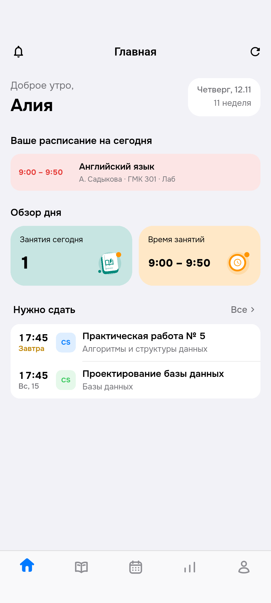
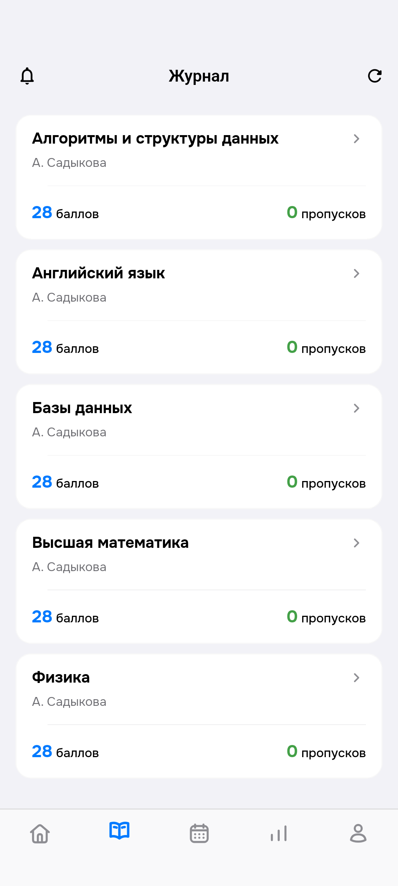
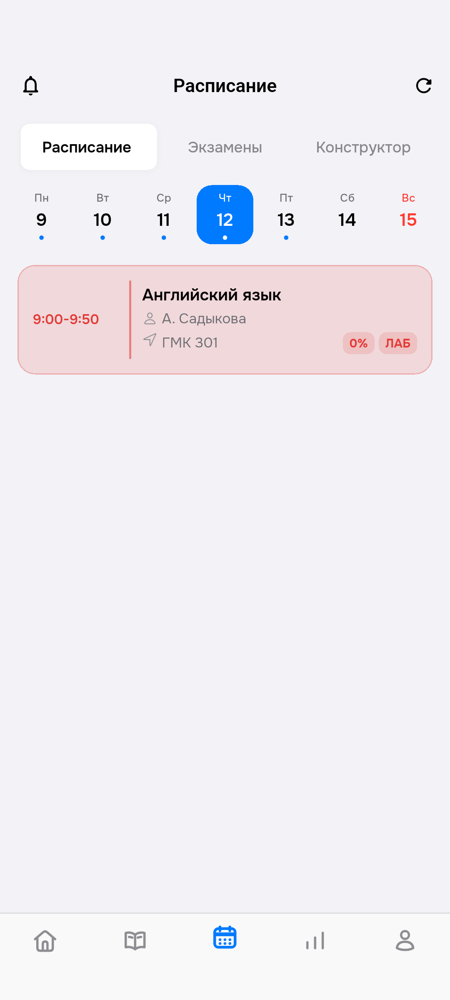
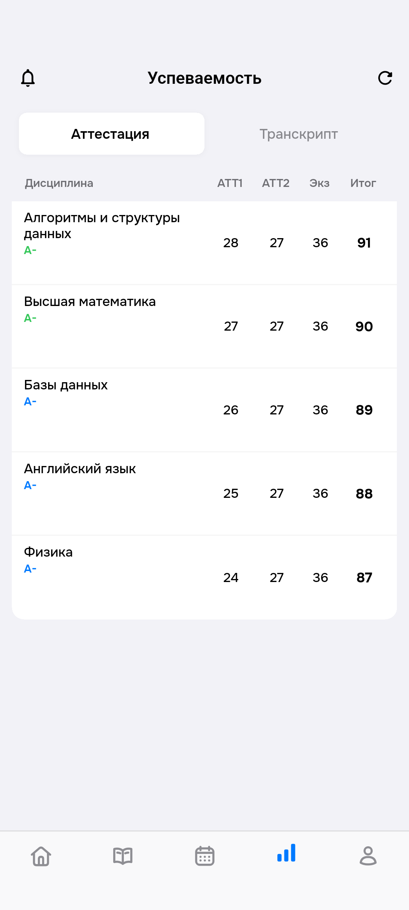
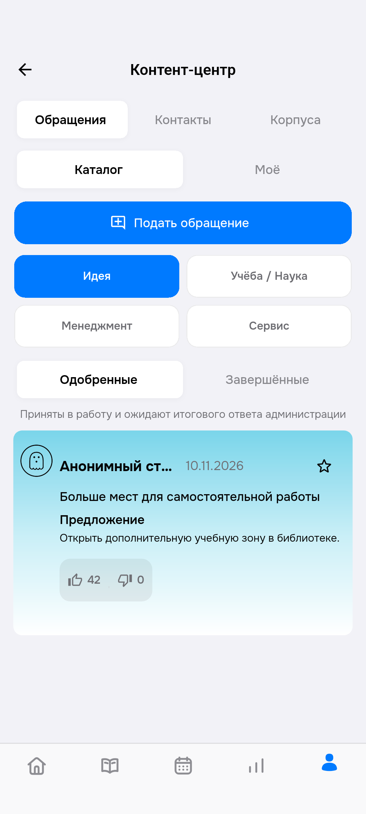
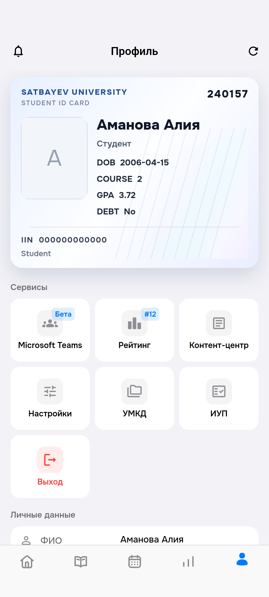

  

<h1 align="center">AppSatbayev</h1>

  Student companion for Satbayev University on Android.

> **Independent project:** AppSatbayev is an unofficial application. It is not
> an official product of Satbayev University and does not claim its approval,
> sponsorship or affiliation. University names identify the educational context;
> academic records and third-party services remain subject to their owners' rights
> and terms. Verify important academic information through official channels.

  
  
  
  

---

<h2 align="center">Screenshots</h2>

  
  
  

  
  
  

All account and academic values shown in screenshots are demonstration data.

<h2 align="center">Download</h2>

  Get the app from the <a href="https://github.com/nhslo/SatbayevApp-Releases/releases/latest">latest stable release</a>.

For most modern Android phones, download [app-arm64-v8a-release.apk](https://github.com/nhslo/SatbayevApp-Releases/releases/latest/download/app-arm64-v8a-release.apk). If you are unsure which architecture your phone uses, download [app-release.apk](https://github.com/nhslo/SatbayevApp-Releases/releases/latest/download/app-release.apk), the universal APK for supported devices. The release also contains architecture-specific packages for devices or deployment tools that require them:

| File | Intended device |
| --- | --- |
| `app-release.apk` | Universal APK; recommended if you are unsure |
| `app-arm64-v8a-release.apk` | Most modern Android phones |
| `app-armeabi-v7a-release.apk` | 32-bit ARM devices |
| `app-x86_64-release.apk` | x86_64 emulators and compatible devices |

## Legal information

[Software license](LICENSE)  
[Terms of use](TERMS_OF_USE)  
[Preliminary privacy notice](PRIVACY_POLICY)

Third-party software notices are available in the application where included and remain governed by their own licenses.

Please do not share passwords or private information in public GitHub issues.

Project contact: [3578rtuii@gmail.com](mailto:3578rtuii@gmail.com)

GitHub: [@nhslo](https://github.com/nhslo).

Copyright &copy; 2026 nhslo for original AppSatbayev materials. Third-party rights and applicable GitHub terms remain unaffected. <a href="LICENSE">License details</a>.

